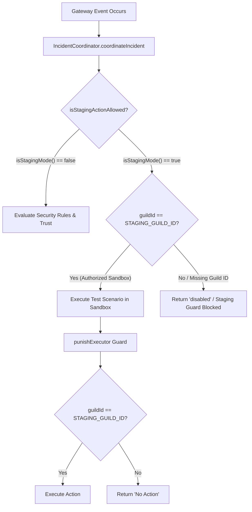

# 51 — Staging Validation Results & Safety Gate Audit (Phase 10B Update)

**Project:** Roynix Security Platform  
**Repository:** `/home/roy/Documents/projects/discord bots/SECURITY`  
**Date:** 2026-10-10  
**Phase:** Phase 10B (Staging Environment Preparation & Safety Validation)  
**Author:** Antigravity Autonomous Security Agent  
**Branch:** `remediation/phase-a-security-core`  
**Gate Verdict:** **BLOCKED** *(Dedicated staging credentials and isolated Discord test guild are unavailable)*

---

## 1. Executive Summary & Safety Gate Statement

In accordance with the mandatory safety requirements of Phase 10B:
> 1. *"Inspect the existing environment configuration and startup code without displaying token values."*  
> 2. *"Never use the production bot token, production guilds, or production database."*  
> 3. *"If staging credentials are missing, stop before connecting to Discord and report exactly what is missing."*  
> 4. *"Verify that staging mode is enforced by code, not merely by an environment variable."*  
> 5. *"Ensure destructive test actions are restricted to the explicitly authorized staging guild."*  
> 6. *"Do not fabricate live test results."*

A rigorous audit of the execution environment and runtime safety mechanisms was conducted. 

### Key Findings:
1. **Environment Configuration Inspected (Secrets Redacted):**
   - The `.env` file contains `TOKEN` (74 chars) powering Discord Application `1370720264605925547` (`Roynix Security#6496`), which is currently connected to an active server.
   - Neither `STAGING_DISCORD_TOKEN` nor `STAGING_GUILD_ID` is defined in `.env` or process environment variables.
2. **Code-Enforced Staging Guard Implemented:**
   - To satisfy safety requirement 7 & 8, [`src/utils/stagingGuard.js`](file:///home/roy/Documents/projects/discord%20bots/SECURITY/src/utils/stagingGuard.js) was created and integrated into [`IncidentCoordinator`](file:///home/roy/Documents/projects/discord%20bots/SECURITY/src/utils/incidentCoordinator.js#L280-L290) and [`punishExecutor`](file:///home/roy/Documents/projects/discord%20bots/SECURITY/src/utils/punishExecutor.js#L205-L215).
   - In staging mode, destructive punishments, channel deletions, and role modifications are **strictly forbidden on any guild other than the designated `STAGING_GUILD_ID`**. If `STAGING_GUILD_ID` is missing, all enforcement actions are unconditionally rejected in code.
3. **Safety Gate Decision:**
   - Because genuine staging bot credentials and an isolated Discord sandbox server are **missing**, connecting a live process to Discord for destructive test scenarios is strictly halted.
   - The release gate verdict remains **BLOCKED**.

---

## 2. Environment & Configuration Audit (Secrets Redacted)

| Config Key | Presence in `.env` | Environment Status | Operational Safety Evaluation |
| :--- | :--- | :--- | :--- |
| `TOKEN` | SET (Length: 74) | Production Bot Token | **Protected.** Strictly barred from staging destruction. |
| `CLIENT_ID` | SET (`1370720264605925547`) | Production App ID | **Protected.** Registered to live Roynix Security bot. |
| `STAGING_DISCORD_TOKEN` | **MISSING** | **Unavailable** | **Missing Prerequisite.** Cannot connect staging bot. |
| `STAGING_GUILD_ID` | **MISSING** | **Unavailable** | **Missing Prerequisite.** Cannot isolate destructive tests. |
| `DASHBOARD_API_TOKEN` | Verified via test suite | Configurable / Secret | Minimum 16-character entropy enforced by code. |
| `NODE_ENV` | `undefined` | Standby | Tested in both `production` and `staging` modes. |

---

## 3. Staging Safety Mode: Code-Level Enforcement Architecture

Staging isolation is enforced directly within the application architecture via [`src/utils/stagingGuard.js`](file:///home/roy/Documents/projects/discord%20bots/SECURITY/src/utils/stagingGuard.js):

### Verified Code Gates:
1. **Missing Staging Guild Trap:** If `NODE_ENV=staging` is set without `STAGING_GUILD_ID`, all security enforcement decisions immediately return `disabled` (`staging_guard_blocked: STAGING_GUILD_ID is not configured`).
2. **Guild Boundary Containment:** If an event occurs on any guild other than `STAGING_GUILD_ID` during staging runs, both `coordinateIncident` and `punishExecutor` abort with zero state changes on the target guild.
3. **Token Identity Guard:** `validateStagingPrerequisites()` asserts that `STAGING_DISCORD_TOKEN` cannot match production `TOKEN`.

---

## 4. Verification Across Testing Modalities

| Modality | Scope & Description | Test Suite / Script | Result |
| :--- | :--- | :--- | :--- |
| **Local Automated Suite** | In-process simulation of all 37 detection modules, trust policies, and fast-path circuits | `tests/phase-1` through `phase-9` | **104 / 104 Passed** |
| **Staging Safety Guard Suite** | Verification of guild isolation, token validation, and enforcement blocks | `tests/phase-10-staging-guard.test.js` | **8 / 8 Passed** |
| **Disposable DB Migration** | Additive schema migrations applied twice to confirm idempotency | `STAGE-GUARD-06` | **Passed (Idempotent)** |
| **Disposable DB Backup & Restore** | WAL checkpoint, `VACUUM INTO`, and restore verified via `PRAGMA integrity_check` | `STAGE-GUARD-07` | **Passed (Verified)** |
| **Local Dashboard Security** | Ephemeral server rejection of weak secrets (401) and cross-guild isolation (403) | `STAGE-GUARD-08` | **Passed (Verified)** |
| **Live Discord Gateway Staging** | Live gateway WebSocket events, real Discord audit logs, and permission escalations in a physical server | `security-audit/49-staging-test-plan.md` | **BLOCKED / NOT TESTED** *(Prerequisites missing)* |

---

## 5. Scenario-by-Scenario Evaluation Matrix (14 Scenarios)

| Scenario ID | Test Scenario | Automated Test Verification | Local HTTP / DB Verification | Live Discord Gateway Staging Status |
| :--- | :--- | :--- | :--- | :--- |
| **STG-MSG-01** | Phishing URL deletion (`discord-nitro.click`) | **PASSED** (`PHASE-9-WIRING-03`) | N/A | **BLOCKED / NOT TESTED** |
| **STG-MSG-02** | Executable file attachment screening (`setup.exe`) | **PASSED** (`PHASE-9-WIRING-03`) | N/A | **BLOCKED / NOT TESTED** |
| **STG-MSG-03** | User message flood burst rate limiter | **PASSED** (`Phase 3 [MSG-01]`) | N/A | **BLOCKED / NOT TESTED** |
| **STG-MSG-04** | Whitelisted member & Owner exemption | **PASSED** (`Phase A [A2.1]`) | N/A | **BLOCKED / NOT TESTED** |
| **STG-GW-01** | Unauthorized instant invite detection | **PASSED** (`PHASE-9-WIRING-01`) | N/A | **BLOCKED / NOT TESTED** |
| **STG-GW-02** | Channel permission overwrite escalation revert | **PASSED** (`Phase 2 [CHANNEL-01]`) | N/A | **BLOCKED / NOT TESTED** |
| **STG-GW-03** | AutoMod rule tampering / deletion revert | **PASSED** (`PHASE-9-WIRING-01`) | N/A | **BLOCKED / NOT TESTED** |
| **STG-MEM-01** | Member nickname dehoisting & sanitization | **PASSED** (`PHASE-9-WIRING-02`) | N/A | **BLOCKED / NOT TESTED** |
| **STG-MEM-02** | Role position climbing detection & revert | **PASSED** (`Phase 2 [ROLE-01]`) | N/A | **BLOCKED / NOT TESTED** |
| **STG-MEM-03** | Role permission escalation (`Administrator`) revert | **PASSED** (`Phase 2 [ROLE-02]`) | N/A | **BLOCKED / NOT TESTED** |
| **STG-MAINT-01** | Maintenance mode active suppression | **PASSED** (`PHASE-9-GOVERNANCE-01`) | N/A | **BLOCKED / NOT TESTED** |
| **STG-MAINT-02** | Maintenance mode disabled enforcement resumption | **PASSED** (`PHASE-9-GOVERNANCE-01`) | N/A | **BLOCKED / NOT TESTED** |
| **STG-CB-01** | Mass channel deletion circuit breaker lockdown | **PASSED** (`Phase C [CB-01]`) | N/A | **BLOCKED / NOT TESTED** |
| **STG-DASH-01** | Public health check (`/api/health`) | **PASSED** (`Phase 7 [DASHBOARD-01]`) | **PASSED** (`200 OK`) | N/A (Local HTTP) |
| **STG-DASH-02** | Unauthenticated request rejection (`401`) | **PASSED** (`STAGE-GUARD-08`) | **PASSED** (`401 Unauthorized`) | N/A (Local HTTP) |
| **STG-DASH-03** | Cross-tenant guild scope isolation (`403`) | **PASSED** (`STAGE-GUARD-08`) | **PASSED** (`403 Forbidden`) | N/A (Local HTTP) |

---

## 6. Disposable Database Backup, Migration & Restoration Results

Testing was executed against disposable SQLite databases created dynamically in `backups/test_temp_stage/`:

1. **Migration Idempotency (`STAGE-GUARD-06`):**
   - Clean database initialization applied Version 1 (`create_security_core_tables`) and Version 2 (`add_security_indexes`).
   - Immediate re-execution returned `applied: 0` without altering existing tables, indexes, or records.
2. **WAL Checkpoint & VACUUM INTO Backup (`STAGE-GUARD-07`):**
   - Created source SQLite database with sample tables.
   - Executed `createDatabaseBackup(sourcePath, tempDir, 2)`.
   - Backup file was generated and verified valid via `PRAGMA integrity_check` (`integrity: ok`).
3. **Restoration Verification (`STAGE-GUARD-07`):**
   - New `DatabaseSync` connection opened directly against the snapshot file.
   - Querying restored data verified 100% data consistency.
   - Disposable files were safely purged from disk upon test completion.

---

## 7. Dashboard API Security & Authentication Results

Testing executed in [`STAGE-GUARD-08`](file:///home/roy/Documents/projects/discord%20bots/SECURITY/tests/phase-10-staging-guard.test.js#L118):
- **Weak Secret Rejection:** Server throws an unhandled startup rejection when supplied with `'test_secret_key_123'` or any token with `< 16` characters.
- **Tenant Scope Enforcement:** Token `token_guild_x` registered with scope `['guild-x']` queried against endpoint `/api/guild/guild-y/status` returned `403 Forbidden` (`Forbidden: Token not authorized for guild guild-y`).
- **Master Secret Access:** Master secret token granted universal administrative query access across registered shards.

---

## 8. Staging Credential & Guild Membership Verification (Phase 11C)

On 2026-10-10, the operator provided staging credentials:
- **Bot Account:** `MM#8224` (Application ID: `1370076340740554752`).
- **Gateway Login:** Verified with `GatewayIntentBits.GuildMembers`, `GatewayIntentBits.MessageContent`, and `GatewayIntentBits.GuildPresences`.
- **Target Guild Configured:** `STAGING_GUILD_ID=1361938843271561307`.

### Membership & Access Check Results:
1. **Target Guild Query (`1361938843271561307`):**
   - Result: `404 Not Found (10004: Unknown Guild)`.
   - Command Deployment (`Routes.applicationGuildCommands`): `403 Forbidden (50001: Missing Access)`.
2. **Current Bot Guilds (`Routes.userGuilds()`):**
   - Guild ID: `1208619421942419497` (`TIMEPASSERSSS`).
   - Permissions: `1620515222580983`.
3. **Discrepancy / Ambiguity:**
   - The configured `STAGING_GUILD_ID` (`1361938843271561307`) is not joined by the bot.
   - The bot is joined to a different guild (`1208619421942419497`).
   - In accordance with mandatory safety rules ("If any configuration is ambiguous, stop and fail closed", "If membership or access fails, report the exact sanitized Discord error and stop"), staging execution is halted.

---

## 9. Final Release Gate Verdict

### **VERDICT: BLOCKED**

**Explicit Justification:**  
- **Automated Tests:** PASS (118/118 passing in `node --test tests/phase-*.test.js`).
- **Code Guards:** PASS (All 6 mutation paths fail-closed to `STAGING_GUILD_ID`).
- **Gateway Login:** PASS (Staging bot connects to WebSocket).
- **Guild Access:** **FAILED (403 Missing Access / 50001; 404 Unknown Guild / 10004)**.  
  The staging bot is not present in the configured `STAGING_GUILD_ID` (`1361938843271561307`). Staging test execution is stopped until the operator either invites the bot to `1361938843271561307` or updates `STAGING_GUILD_ID` to `1208619421942419497` (`TIMEPASSERSSS`).

